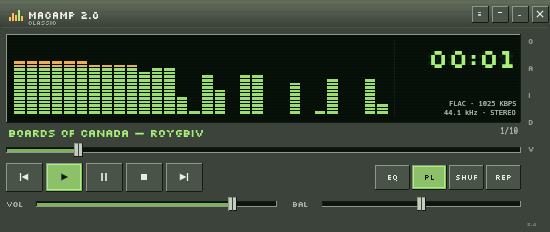
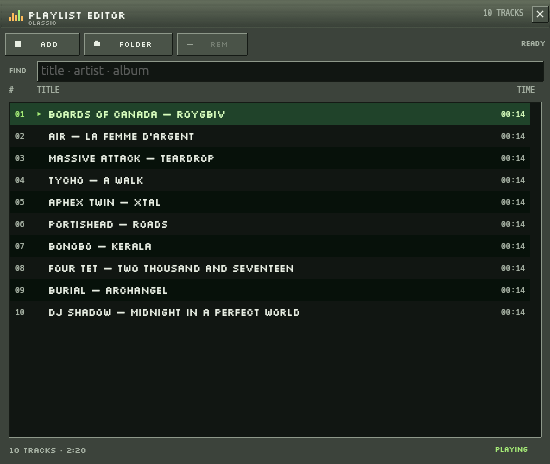
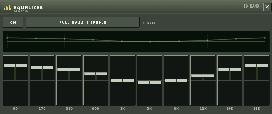

# MacAmp

Музыкальный плеер для macOS в духе классического Winamp: собственные окна,
Graphite-скин, LED-спектр, плейлист, эквалайзер и Now Playing. Написан на Rust
с egui; звук — Rodio и Symphonia.



Windowshade — двойной клик по тайтлбару:


| Плейлист | Эквалайзер |
|---|---|
|  |  |

## Что уже работает

- Одно долгоживущее аудиоустройство, gapless-переходы и предзагрузка следующего трека.
- Play / Pause / Stop, перемотка, громкость, баланс, переход к следующему и предыдущему треку.
- Теги, длительность, битрейт и частота дискретизации из файлов (lofty); при отсутствии тегов — имя файла.
- Очередь с добавлением файлов и папок, drag & drop из Finder, удалением и двойным кликом для запуска.
- Фильтр по названию, артисту, альбому и пути (`FIND`), поиск без учёта регистра.
- Перестановка треков перетаскиванием строк; порядок, текущий трек и play-order сохраняются.
- Удаление треков прямо во время воспроизведения (кроме текущего) с перестройкой очереди и lookahead.
- Восстановление сессии: очередь, текущий трек, позиция, громкость, скин, EQ и положение окон.
- 10-полосный эквалайзер с пресетами и настоящей biquad-обработкой звука.
- Graphite / Midnight / Brass, переключение через меню заголовка.
- Now Playing в Control Center и медиа-клавиши через souvlaki.
- Реальный FFT-спектр из аудиопотока.
- Кастомные окна без системного заголовка: перетаскивание, закрытие, отдельные Main / Playlist / Equalizer.
- Windowshade: двойной клик по тайтлбару сворачивает главное окно в компактную LED-панель.
- Double size (`⌘D`): весь интерфейс, включая плейлист и EQ, удваивается.
- Окна стыкуются краями и группируются: главное окно тянет за собой пристёгнутые плейлист и эквалайзер.
- Плейлист ресайзится за угол и запоминает свой размер между запусками.
- `.app`-бандл с иконкой и Info.plist; ассоциации файлов через Finder — следующий шаг.

## Запуск

Нужен стабильный Rust 1.95+ (edition 2021) и инструменты Xcode.

```sh
cargo run
cargo run -- "/path/to/album" "/path/to/song.flac"
```

Собрать `dist/MacAmp.app`:

```sh
./scripts/bundle_macos.sh
open dist/MacAmp.app
```

Поддерживаемые форматы: MP3, FLAC, WAV, M4A/AAC, OGG Vorbis.
Опус пока не подключён.

## Управление

| Действие | Клавиши / кнопка |
|---|---|
| Play / Pause | `Space` |
| Стоп | `V` |
| Следующий / предыдущий | `B` / `Z` |
| Seek −5 / +5 секунд | `←` / `→` |
| Громкость | `↑` / `↓` или `+` / `-` |
| Открыть файлы | `⌘O` |
| Открыть папку | `⌘⇧O` |
| Запустить выбранный трек | `Enter` или двойной клик |
| Удалить выбранный трек | `Delete` (кроме текущего играющего) |
| Фильтр плейлиста | поле `FIND`, `Esc` — очистить |
| Переставить трек | перетащить строку (при пустом фильтре) |
| Плейлист | кнопка `PL` |
| Эквалайзер | кнопка `EQ` |
| Shuffle / повтор | `SHUF` / `REP` |
| Windowshade | двойной клик по тайтлбару |
| Double size | `⌘D` или пункт меню |
| Размер плейлиста | тянуть за угол в правом нижнем углу |

Меню в заголовке главного окна: скины, always-on-top, windowshade, double size,
плейлист, открытие файлов, About и выход. Плейлист и эквалайзер можно двигать и
закрывать отдельно.

## Где лежат данные

```
~/Library/Application Support/com.macamp.MacAmp/config.json
~/Library/Application Support/com.macamp.MacAmp/logs/macamp.log
```

Для тестовых запусков каталог можно переопределить через `MACAMP_DATA_DIR`.

## Устройство

- `src/audio.rs` — один `OutputStream`, очередь Rodio `Player`, seek/volume, баланс, tap для FFT, EQ-цепочка на biquad.
- `src/metadata.rs` — фоновый загрузчик тегов и фоновое сканирование папок.
- `src/spectrum.rs` — FFT-анализатор для LED-спектра.
- `src/theme.rs`, `src/widgets.rs` — палитры и отрисовка классического интерфейса без виджетов egui.
- `src/platform.rs` — Now Playing и медиа-клавиши.
- `src/app.rs` — состояние сессии, окна, ввод и склейка всего.
- `src/config.rs` — сохранение сессии, пути, логирование.
- `scripts/bundle_macos.sh` — сборка `.app`.
- `.github/workflows/ci.yml` — fmt, clippy, тесты.

Проверки:

```sh
cargo fmt --all -- --check
cargo clippy --all-targets -- -D warnings
cargo test
```

## Что дальше

Ближайшие большие куски: удаление треков во время воспроизведения, библиотека на
SQLite, импорт `.wsz`-скинов, умные плейлисты и MilkDrop-визуализация.

[Продуктовый бриф](docs/winamp_style_mac_music_player_brief.md)

Текущее состояние, dev-флаги и детали для следующей сессии: [docs/HANDOFF.md](docs/HANDOFF.md).

[Дизайн-концепция и план MacAmp 2.0](docs/macamp_2_0_concept.html) — интерактивный
макет, аудит кодовой базы, хотелки и план развития.
